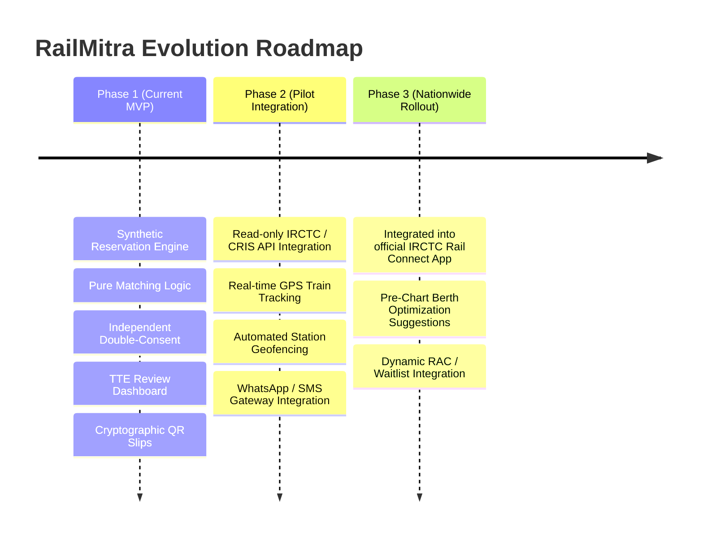

# RailMitra – Product Pitch & Architecture Thesis 🚆💡

**Tagline:** Smart, Consent-Based Railway Seat Exchange & Family Seating System.

---

## 1. Executive Summary

Millions of passengers travel on Indian Railways daily. Due to dynamic automated reservation algorithms and high passenger load, families and groups booking under a single PNR are frequently allocated berths in different coaches or separated across cabins.

Today, the only recourse is **informal, ad-hoc seat swapping**:
- Passengers verbally solicit co-passengers once on board.
- Solo travelers, senior citizens, and women often feel pressured into suboptimal swaps.
- Swaps are completely invisible to the Train Ticket Examiner (TTE), creating verification confusion during ticket checking.
- Passengers boarding at later intermediate stations often find their assigned berths occupied by strangers.
- Families needing coordinated multi-berth exchanges have no systemic mechanism to arrange them.

**RailMitra** replaces informal friction with an automated, consent-driven, TTE-authorized digital platform.

---

## 2. Core Pillars & Differentiators

### A. Independent Device-Level Consent
Informal swaps suffer from social coercion. In RailMitra, an exchange is **only** initiated when the requesting passenger sends a formal digital offer. The target passenger reviews the exact berth details (coach, berth number, berth type, and journey segment) on their own authenticated device and decides freely without peer pressure.

### B. Pure Algorithmic Matching with Vulnerability Safeguards
RailMitra’s matching engine evaluates candidates based on mathematical route overlap:
- **Best Match:** Same destination, exact feasible segment.
- **Possible Match:** Minor destination variance (1–3 stops gap) along the common journey corridor.
- **Senior Citizen & Vulnerability Protection:** Passengers aged 60+ or flagged as requiring lower berths are strictly blocked from being offered middle, upper, or side-upper berths.

### C. Segment-Aware Automatic Expiry
A major problem in informal swaps is when Passenger A swaps with Passenger B, but Passenger B alights two stations earlier. Passenger C then boards at that station and finds their reserved berth occupied.  
RailMitra resolves this through **segment-aware expiry**:
- The exchange is strictly valid only between the **later boarding station** and the **earlier destination station** (`expiry_station`).
- When the train reaches the expiry station, the exchange status automatically transitions to `EXPIRED`.
- Both passengers receive immediate notifications: *"Your exchange has expired. Please return to your original berth: Coach X, Berth Y."*
- Dynamic seating restores to the original reservation chart.

### D. Anti-Harassment & Anti-Spam Quota
To prevent strangers from pestering fellow passengers repeatedly:
- Each passenger is limited to a strict maximum of **3 exchange requests per journey**.
- Duplicate requests to the same target candidate are blocked server-side (HTTP 409).
- A 4th attempt returns an immediate HTTP 429 (`REQUEST_LIMIT_REACHED`).

### E. Family Group Coordination
For groups of 2 to 6 passengers split across different coaches (e.g. Verma family of 5):
- RailMitra evaluates multi-member permutations simultaneously.
- Individual member quotas are verified before creation.
- Live progress tracking displays confirmation rates (*"3 of 4 confirmed"*).
- The system never auto-finalizes partial arrangements; if one member declines, missing components are clearly reported to the family coordinator.

### F. Train Ticket Examiner (TTE) Dashboard & Audit Trail
- The TTE has a dedicated operational portal (`/static/tte.html`).
- The review queue shows before-and-after coach and berth allocations side-by-side.
- Approval is cryptographically blocked until **both** passenger consents are confirmed.
- The TTE can view a live **Effective Coach Seating Chart** overlaying active exchanges.
- Every OTP dispatch, verification, consent decision, and review action is recorded in an immutable, timestamped `AuditLog`.

### G. Cryptographic Digital Slip with QR Code
- Once approved by the TTE, passengers receive an official digital exchange slip on their mobile devices.
- A client-side generated QR code encodes a tamper-evident SHA-256 token pointing to `/api/verify/{token}`.
- Anyone can verify the token without compromising passenger privacy (zero PNR, phone number, or email data is leaked).

---

## 3. Prototype Boundary & Real-World Constraints

### Clear Boundaries Defined
1. **Simulated Reservation Dataset**: The application operates against simulated train charts and reservation datasets. It does not claim live API access to Indian Railways production systems.
2. **Mandatory Disclaimer**: Every web page and generated exchange slip prominently carries the notice:
   > *"Prototype using a simulated reservation dataset. Not the official Indian Railways reservation chart or database. Official use would require authorization from Indian Railways."*
3. **Physical Enforcement Reality**: RailMitra issues digital notifications and alerts when an exchange expires. However, as noted in the interface:
   > *"Reminders support compliance but cannot physically enforce returning to original berths."*

---

## 4. Future Vision & Integration Roadmap

1. **CRIS / IRCTC Direct Integration**: Integrate RailMitra directly into the official IRCTC *Rail Connect* mobile application and TTE handheld terminals (HHTs).
2. **Pre-Chart Optimization**: Allow families to flag their seating preference before chart preparation, enabling railway allocation algorithms to optimize berth groupings upstream.
3. **GPS Geofenced Expiry**: Utilize device or locomotive GPS sensors to trigger automated expiry reminders 15 minutes prior to arriving at intermediate transfer stations.

---

## 5. Conclusion

RailMitra demonstrates how thoughtful digital design, algorithmic fairness, and strict consent boundaries can solve an everyday problem experienced by millions of Indian train travelers. By empowering passengers with transparency while giving TTEs full operational visibility, RailMitra brings dignity and peace of mind to railway travel.
